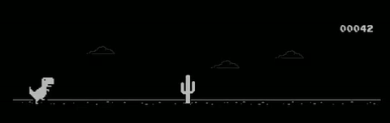
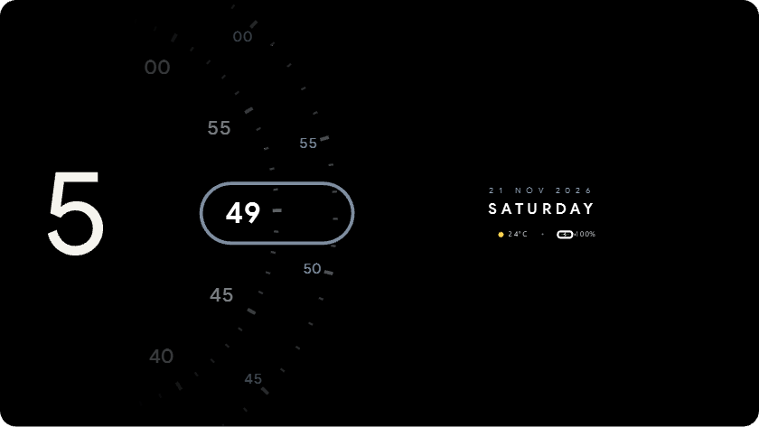
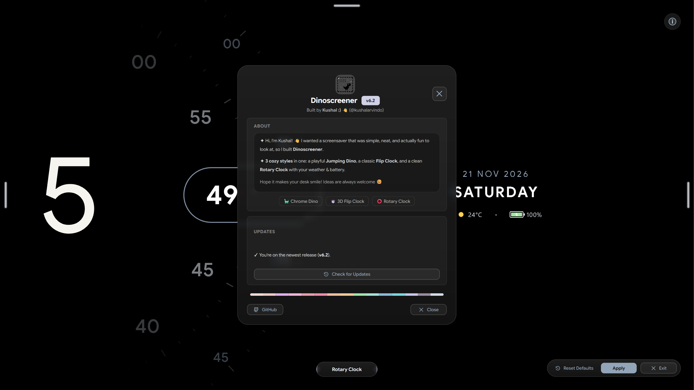

<div align="center">
  
  <h1>🦕 Dinoscreener</h1>
  <p><strong>The modern, ultra-aesthetic clock screensaver suite for Windows & Linux.</strong></p>
  <p>Featuring <strong>Rotary Clock</strong>, <strong>Flip Clock</strong>, and <strong>Dino Runner</strong> with real-time physics, a visionOS-inspired fullscreen studio, and custom typography & sprite imports.</p>

  <p>
    <a href="https://github.com/kushalarvindo/dinoscreener/releases"></a>
    
    
    
    
  </p>
</div>

<br />

<div align="center">
  
</div>

---

## 👋 Hey there!

Tired of boring Windows screensavers that look like they haven't seen an update since Windows XP? Me too.

I built **Dinoscreener** because I wanted something clean, distraction-free, and genuinely aesthetic for my desk setup. Whether you're pulling an all-nighter studying, giving your OLED display a little downtime, or just vibing to lo-fi beats, Dinoscreener turns your monitor into a stunning minimalist centerpiece with flipping tiles, hourly chimes, and an offline Dino runner that actually jumps over cacti in real time.

---

## 🎨 Three Distinct Clock Modes

Switch between them on the fly using the **Up / Down arrow keys**, the floating mode switcher, or right from the visual settings studio!

| Mode | What makes it cool | Preview |
|---|---|---|
| **Rotary Clock** | A hypnotic dual-ring rotary dial calculating rotation angles with exact trigonometry for a sleek spinning wheel effect. Includes real-time weather and battery telemetry. |  |
| **Flip Clock** | Vintage mechanical split-flap aesthetic using 3D perspective scaling to simulate realistic tile drops. Super customizable with leading zero toggles and scale slider. |  |
| **Dino Runner** | The legendary offline Chrome Dino game, running on auto-pilot with authentic gravity physics, obstacles, and the ability to drop in your own custom fonts and character sprites! |  |

---

## 🥽 Spatial Fullscreen Studio Mode (`[ ⛶ ]`)

<div align="center">
  
</div>

Hit **Studio** in the settings menu to enter **Fullscreen Studio Mode** — an immersive, Apple visionOS-inspired interactive control room:

- **True Edge-to-Edge Canvas**: The normal window chrome completely disappears. The live clock fills 100% of your screen on pure `#000000` black so OLED screens can completely shut off their pixels.
- **Luminous Spatial Grabber Bars**: Hover near the sleek glowing pills at the top, left, or right edges to slide out translucent obsidian glass drawers containing your settings.
- **Symmetrical Mode Capsule**: A floating bottom dock lets you switch clock styles instantly while previewing them at your monitor's true full resolution.
- **Glass drawers** keep their frosted look while the clock runs behind them. Studio caches the glass so it can spend its time drawing the clock.
- **Seamless State Sync**: Tweak anything in Fullscreen Studio and tap `Esc` or `✕ Exit` — all your changes instantly sync back to the main settings window without missing a beat.

---

## 🎛️ The Visual Settings Studio

<div align="center">
  
</div>

- Pick a clock under the preview and its settings pop up in the first panel. **Appearance** is for brightness and ambient lighting. **Behavior** is where the hourly chimes live, whichever clock you pick.
- **Drag & Drop Custom Fonts & Sprites**: Don't like the default fonts? Drag and drop any `.ttf` or `.otf` file onto the window to customize clock numbers. Want your own character instead of the Dino? Drag and drop any `.png` sprite!
- **Acoustic Hourly Chimes**: 4 handcrafted chime sounds (*Acoustic Bell*, *Windows Modern Chime*, *Zen Singing Bowl*, *Minimal Watch Ping*), complete with a tactile volume slider and a **Test** button. You can even import your own custom `.wav` chime sound!
- **Burn-in protection** gently moves the clock over time. You can turn it on in Appearance.
- **System Intercepts & Security**:
  - **Strict Exit (`Ctrl + Z`)**: Keeps the screensaver locked on screen against accidental bumps until you enter `Ctrl + Z`.
  - **Ignore Media Keys**: Volume dials and Spotify track skips won't dismiss your screensaver.
  - **Windows Key Guard**: Suppresses accidental Start Menu popups.

---

## ⌨️ Shortcuts & Hotkeys

While the screensaver is running, you're in full control:

| Key | Action |
|---|---|
| **`Spacebar`** | Toggle Ambient Mode backlight orbs (or respawn Dino if game over) |
| **`Arrow Up` / `Arrow Down`** | Switch instantly between Flip Clock, Rotary Clock, and Dino Runner |
| **`+` / `-`** | Scale the clock larger or smaller |
| **`Ctrl + Z`** | Unlock screensaver when Strict Lock is enabled |
| **`Esc`** | Exit Fullscreen Studio Mode back to Settings |

---

## 🚀 Download & Installation

### 🪟 Windows (Recommended)
You can grab the pre-compiled binaries directly from the [Releases](https://github.com/kushalarvindo/dinoscreener/releases) page:

1. **Install as Native Windows Screensaver (`.scr`)**:
   - Download [Dinoscreener.scr](https://github.com/kushalarvindo/dinoscreener/releases/download/v6.2/Dinoscreener.scr).
   - Right-click **`Dinoscreener.scr`** $\rightarrow$ **Install**.
   - The classic Windows Screen Saver dialog will pop up. Click **Settings...** to open the studio!

2. **Standalone Portable App (`.exe`)**:
   - Download [Dinoscreener.exe](https://github.com/kushalarvindo/dinoscreener/releases/download/v6.2/Dinoscreener.exe) and launch it anywhere — no installer required.

> [!NOTE]
> Windows may show a SmartScreen prompt the first time you launch the app.

### 🐧 Linux
1. Grab **`dinoscreener-linux-x86_64.tar.gz`** from [Releases](https://github.com/kushalarvindo/dinoscreener/releases).
2. Extract and run the installer:
   ```bash
   tar -xzvf dinoscreener-linux-x86_64.tar.gz
   cd dinoscreener
   chmod +x install-linux.sh
   ./install-linux.sh
   ```
3. Run `dinoscreener --settings` to customize or `dinoscreener --fullscreen` to start relaxing.

---

## 🛠️ Building from Source

If you like compiling things yourself, here’s the Windows build in PowerShell.

```powershell
git clone https://github.com/kushalarvindo/dinoscreener.git
cd dinoscreener
pip install -r requirements.txt
pyinstaller Dinoscreener.spec --noconfirm
Copy-Item dist/Dinoscreener.exe Dinoscreener.scr
```

---

<div align="center">
  <p>Built with ❤️, Python, and caffeine by <b>Kushal :)</b> 👋 (<a href="https://github.com/kushalarvindo">@kushalarvindo</a>)</p>
  <p>If you enjoy Dinoscreener, give it a ⭐ on GitHub — it means the world!</p>
  <br />
  <a href="https://github.com/kushalarvindo/dinoscreener">
    
  </a>
</div>
