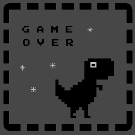
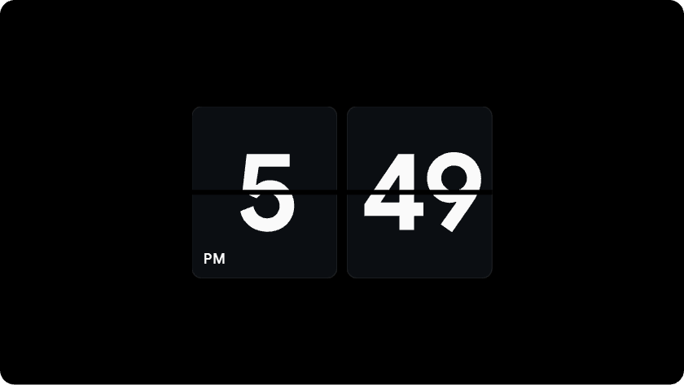
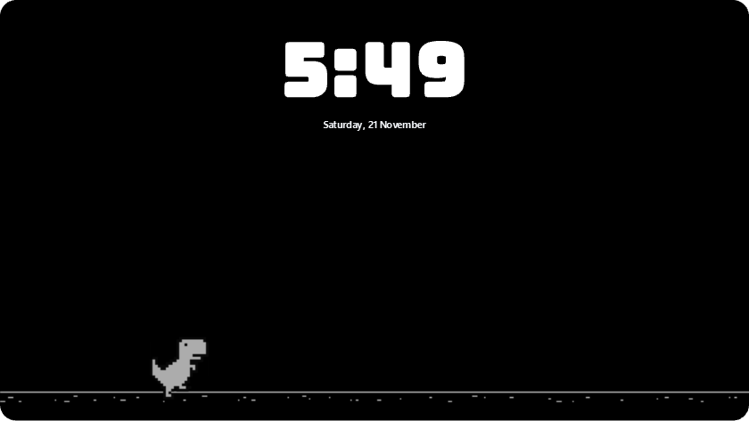
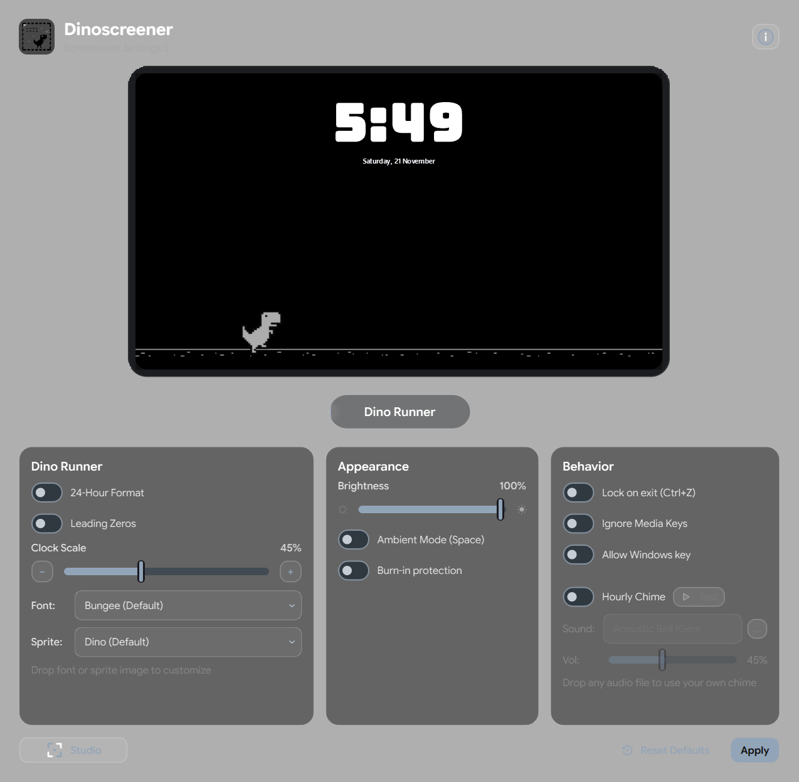

<div align="center">
  
  <h1>Dinoscreener</h1>
  <p>Three clocks for the time your desk has to itself.</p>
  <a href="https://github.com/kushalarvindo/dinoscreener/releases/tag/v6.2">Download v6.2 for Windows or Linux</a>
</div>

## Hey, I'm Kushal 👋

I wanted a clock I’d actually leave running on my desk. Some days that’s two big flip cards on a black screen. Other days it’s a little dino trying to clear the next cactus. Dinoscreener lets me switch between the two, with a rotary dial for the days I want the weather there too.

## Pick your clock

| Mode | On your screen | Preview |
| --- | --- | --- |
| **Flip Clock** | Two split-flap cards drop into place as the time changes. Adjust their size, switch to 24-hour time, or give single-digit hours a leading zero. |  |
| **Rotary Clock** | Two numbered rings sweep past a fixed marker. Pick a dial accent and choose whether the weather and battery sit beside the date. |  |
| **Dino Runner** | The clock keeps time above a dino that jumps cacti on its own. Set the clock size or drop in your own font and sprite. |  |

## A look inside Settings

<div align="center">
  
</div>

Start with the little mode selector under the preview. The first panel changes with your clock. **Appearance** holds brightness, ambient lighting and burn-in protection. **Behavior** is where you’ll find exit controls and the hourly chime. You can audition a bell, set its volume or bring your own audio file.

Want to see how the dial looks from across the room? Open **Studio**. Move to the screen edges to reveal the same controls over the full-size clock. **Exit** brings you back to Settings. Use **Apply** to save your choices.

## Get it running

**Windows.** Download the screensaver, right-click it and choose **Install**. Windows opens Screen Saver Settings, where **Settings…** takes you to the live preview above. For a portable copy, launch the executable directly or run `Dinoscreener.exe --settings` to configure it. [Screensaver (.scr)](https://github.com/kushalarvindo/dinoscreener/releases/download/v6.2/Dinoscreener.scr) · [Portable app (.exe)](https://github.com/kushalarvindo/dinoscreener/releases/download/v6.2/Dinoscreener.exe)

**Linux (x86-64).** Download the archive and run the commands below from your downloads folder. The installer adds Dinoscreener to your application menu. Launch it there for Settings, or run `~/.local/bin/dinoscreener --fullscreen` for the clock. [Linux archive](https://github.com/kushalarvindo/dinoscreener/releases/download/v6.2/dinoscreener-linux-x86_64.tar.gz)

```sh
tar -xzf dinoscreener-linux-x86_64.tar.gz
cd dinoscreener
./install-linux.sh
```

## Keys worth knowing

| While the screensaver is running | What it does |
| --- | --- |
| ↑ / ↓ | Cycle through the three clocks. |
| + / − | Resize the current clock. |
| Space | Toggle ambient lighting. If the dino has crashed, Space starts its run again. |
| Ctrl+Z | Exit when **Lock on exit** is enabled. |

In **Studio**, press **Esc** to return to Settings.

## Run it from source

With Python installed, run these commands from the project folder. The first launch opens Settings so you can pick a clock.

```sh
python -m pip install -r requirements.txt
python screensaver.py --settings
```

To build the Windows screensaver, run these in PowerShell.

```powershell
python -m PyInstaller --noconfirm Dinoscreener.spec
Copy-Item dist/Dinoscreener.exe Dinoscreener.scr
```

Built by [Kushal :)](https://github.com/kushalarvindo). If something looks off on your screen, tell me which clock you were using and what happened. [Open an issue](https://github.com/kushalarvindo/dinoscreener/issues)


