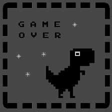
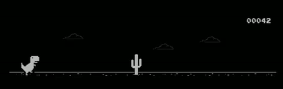

<div align="center">
  
  <h1>🦕 Dinoscreener</h1>
  <p><strong>A stunning, ultra-minimalist modern clock screensaver suite for Windows & Linux.</strong></p>
  <p>Featuring <strong>Modern Rotary</strong>, <strong>Classic Flip Clock</strong>, and <strong>Chrome Dino Runner</strong> with custom typography & sprite imports.</p>

  <p>
    <a href="https://github.com/kushalarvindo/dinoscreener/releases"></a>
    
    
    
    
  </p>
</div>

<br />

<div align="center">
  
</div>

---

## ✨ Features & Architecture

Dinoscreener is built natively using **Python** and **PyQt6**. It renders buttery-smooth 60 FPS antialiased graphics drawn using vector `QPainter` geometry and real-time physics.

### 🎨 Clock Modes

Dinoscreener features three distinct, meticulously crafted clock styles. Switch between them instantly using the **Up/Down arrow keys** or via the interactive settings dialog!

| Mode | Description | Preview |
|---|---|---|
| **Modern Rotary** | A dual-ring rotary interface calculating exact rotation angles using trigonometry for a seamless spinning wheel effect with optional Weather & Battery telemetry. |  |
| **Classic Flip Clock** | A retro mechanical flip-clock style utilizing 3D perspective scaling to visually compress flip tiles, customizable scaling, and leading zero toggles. |  |
| **Chrome Dino Game** | An authentic auto-playing Chrome Dino runner with accurate gravity physics, procedurally generated obstacles, and custom typography/sprites. |  |

---

### 🎛️ Modern Spatial Settings Studio

<div align="center">
  
</div>

- **16:9 Authentic Widescreen Preview**: Real-time live canvas displaying exact font scaling, sprite styling, and visual luminance before applying.
- **Symmetrical Capsule Mode Switcher**: A minimalist pill indicator that automatically expands on hover into a floating segmented switcher, featuring corner-anchored directional indicator dots and dead-centered active mode typography.
- **Windows 11 Dynamic Accent Color**: Automatically reads your Windows 11 accent color (`DWM / AccentColorMenu`) and harmonizes buttons, sliders, duotone icons, and checkboxes with your desktop theme.
- **Custom Typography & Sprite Engine**: Simply **drag and drop** any `.ttf` / `.otf` font file or `.png` / `.jpg` sprite image directly onto the window to customize clock numbers or character sprites. Revert anytime with one click.
- **Ambient Lighting Mode**: Soft, silky background glow orbs that can be toggled via the settings menu or instantly with the **Spacebar**.
- **Tactile Luminance & Scale Controls**: Full-width brightness slider (10% to 100%) and interactive scale slider with tactile `-` / `+` micro-adjusters.
- **Per-Monitor v2 High-DPI Super-Sampling**: Crystal-sharp vector graphics, smooth bilinear pixmap interpolation (`SmoothPixmapTransform`), and antialiased DirectWrite typography across 100%, 125%, 150%, 175%, and 200% displays on 2K and 4K monitors.
- **Hardware-Grade OLED Burn-in Protection**: Continuous Lissajous orbital subpixel shifting ($\pm 8\text{px} \times \pm 6\text{px}$ over a 2.6–4.2 min period) redistributes luminous diode wear across 2K and 4K OLED panels to prevent static element burn-in.
- **High-Refresh Smoothness (165Hz/144Hz/120Hz)**: Dynamic delta-time physics and frame pacing eliminate micro-stutters and judder in the Chrome Dino runner across high-refresh gaming displays.
- **Dynamic Frame Throttle (Power Optimization)**: Intelligently throttles frame rates down to 1 FPS when the clock is static, slashing idle CPU consumption from ~45% of a core to < 0.5% while instantly snapping to native refresh rates during card flips and game runs.
- **Multi-Preset Acoustic Hourly Chimes & Volume Control**: Choose from 4 built-in synthesized chime styles (*Acoustic Bell*, *Windows Modern Chime*, *Zen Singing Bowl*, *Minimal Watch Ping*), dial in your preferred volume with a tactile slider (5% to 100%), or drag-and-drop any custom audio file (`.wav`, `.mp3`, `.ogg`, `.flac`) with one-click test preview!
- **Automated In-App Update Checker & Info Dialog (`ⓘ`)**: Automatic background checks against GitHub Releases, notifying you of updates with one-click download, verification, and automatic installation handoff. Featuring an authentic, golden-ratio balanced creator profile.
- **Independent Telemetry & Weather Feeds**: Toggle Weather and Battery displays independently (centered alone or joined with a separator dot), and toggle between Celsius (`°C`) and Fahrenheit (`°F`).
- **Cross-Platform Battery Telemetry**: Native battery reading via `kernel32` on Windows and `/sys/class/power_supply` on Linux laptops.
- **Strict Exit & System Intercepts**:
  - **Lock Screen on Exit (`Ctrl + Z`)**: Keeps the screensaver active even on mouse movement; requires `Ctrl + Z` to unlock.
  - **Ignore Media Keys**: Prevents volume knobs or Spotify track changes from prematurely closing the screensaver.
  - **Windows Key Guard**: Disables the Windows key to prevent accidental taskbar pops.

---

## ⌨️ Controls & Keyboard Shortcuts

While the screensaver is running, you can use these keyboard shortcuts to modify it in real time:

- **`Spacebar`**: Toggle Ambient Mode glow orbs (or restart Dino game after Game Over).
- **`Arrow Up` / `Arrow Down`**: Toggle between Flip Clock, Rotary Modern, and Chrome Dino clock styles.
- **`+` (Plus) / `-` (Minus)**: Scale the clock size up or down in real time.
- **`Ctrl + Z`**: Unlock / exit the screensaver when "Lock Screen on Exit" (Strict Exit) is enabled.

---

## 🚀 Quick Setup (Pre-Compiled)

### 🪟 Windows Setup
You can use Dinoscreener in two ways on Windows:

1. **Native Screensaver Mode (`.scr`)**:
   - Download **`Dinoscreener.scr`** from the [Releases](https://github.com/kushalarvindo/dinoscreener/releases) page.
   - Right-click on **`Dinoscreener.scr`** and select **Install**.
   - The Windows Screen Saver Settings dialog will open automatically. Click **Settings...** to customize your preferences!

2. **Standalone Desktop Mode (`.exe`)**:
   - Download **`Dinoscreener.exe`** from the [Releases](https://github.com/kushalarvindo/dinoscreener/releases) page.
   - Double-click to run immediately without needing installation.

> [!WARNING]
> **Windows Defender Notice**  
> Because `Dinoscreener.scr` is compiled into a standalone executable without an expensive enterprise code-signing certificate, Windows Defender SmartScreen might prompt an unrecognized binary notice.  
> **This is normal and safe.** The entire codebase is 100% open source. To proceed, click **More Info** $\rightarrow$ **Run Anyway** (or select **Allow on device** in Windows Security).

### 🐧 Linux Setup
1. Download **`dinoscreener-linux-x86_64.tar.gz`** from the [Releases](https://github.com/kushalarvindo/dinoscreener/releases) page.
2. Extract the archive and run the one-click installer:
   ```bash
   tar -xzvf dinoscreener-linux-x86_64.tar.gz
   cd dinoscreener
   chmod +x install-linux.sh
   ./install-linux.sh
   ```
3. Launch **Dinoscreener** from your application menu, or run from the command line:
   - `dinoscreener` or `dinoscreener --settings` $\rightarrow$ Opens the visual settings studio.
   - `dinoscreener --fullscreen` or `dinoscreener -s` $\rightarrow$ Launches the screensaver directly in fullscreen.

---

## 🛠️ How to Compile It Yourself

If you prefer building the binary directly from source:

### Prerequisites
- Python 3.10+
- `pip` package manager

### Windows Build Steps
```cmd
git clone https://github.com/kushalarvindo/dinoscreener.git
cd dinoscreener
pip install -r requirements.txt
pyinstaller Dinoscreener.spec --noconfirm
copy /y dist\Dinoscreener.exe Dinoscreener.scr
```

### Linux Build Steps
```bash
git clone https://github.com/kushalarvindo/dinoscreener.git
cd dinoscreener
pip install -r requirements.txt
pyinstaller --noconfirm --onefile --windowed --add-data "Bungee-Regular.ttf:." --add-data "app_icon.png:." --name dinoscreener screensaver.py
chmod +x dist/dinoscreener
./dist/dinoscreener --settings
```

---

<div align="center">
  <a href="https://github.com/kushalarvindo/dinoscreener">
    
  </a>
  <br /><br />
  <p>Crafted with precision using Python & PyQt6</p>
</div>
